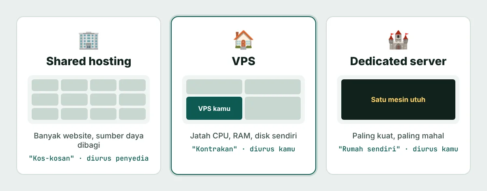
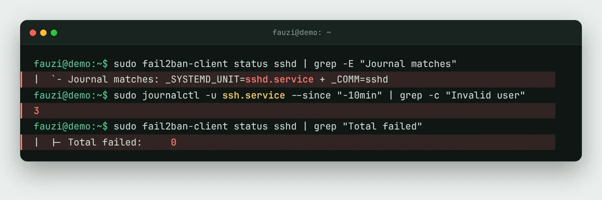
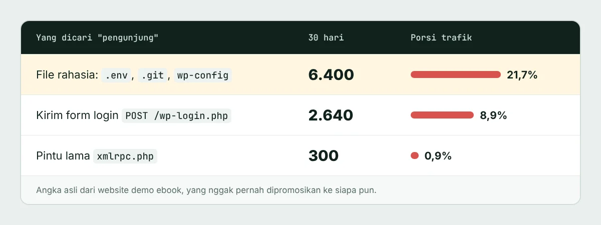
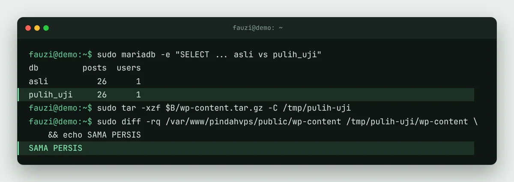
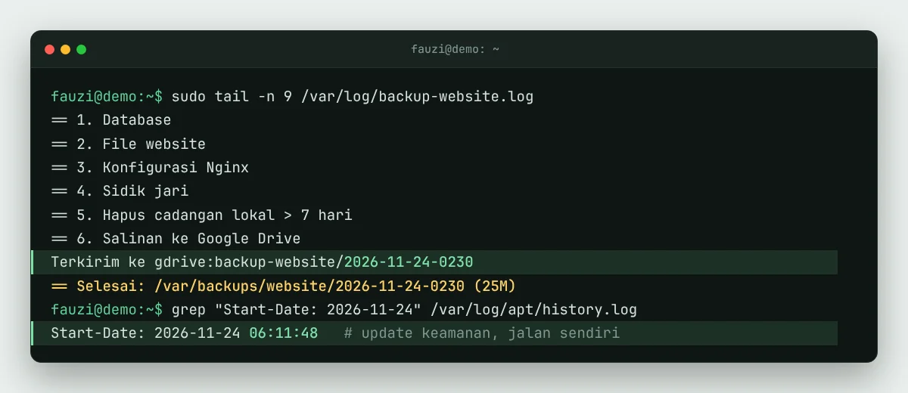

## "Pindah ke VPS aja, Pak."

Pak Hendra, operator di SMK Contoh, punya masalah yang datang tiap bulan Juni. Pengumuman PPDB keluar, ratusan orang tua buka website bareng, dan yang muncul cuma tulisan `508 Resource Limit Is Reached`. Vendor yang dulu bikin websitenya cuma bilang satu kalimat: pindah ke VPS aja.

Saran itu nggak salah. Tapi juga belum tentu benar. Cara paling gampang memahaminya, bayangin tempat tinggal:

<figure class="eb-fig">
  
  <figcaption>Gambar 1 · Shared hosting itu kos-kosan, VPS itu kontrakan, dedicated itu rumah sendiri.</figcaption>
</figure>

Di kos, ada ibu kos yang ngurus pompa air. Di kontrakan, kamu bebas cat dinding warna apa aja, tapi **genteng bocor sekarang urusanmu sendiri**. Kunci hilang, atap bocor, maling masuk, semuanya kamu yang urus.

Makanya Bab 1 justru dibuka dengan bagian yang jarang ditulis orang yang jualan VPS: kapan kamu **belum** butuh VPS. Ada empat tanda kamu sebaiknya tetap di hosting biasa, dan salah satunya bikin banyak orang batal pindah setelah sadar masalahnya ternyata bukan di hostingnya, tapi di...

## Pengaman yang nyala, tapi buta

Bagian 4 adalah bagian terbesar di ebook ini, karena server yang online tanpa pengamanan cuma soal waktu sampai dibobol. Salah satu pengamannya Fail2ban, satpam yang mengusir tukang tebak password SSH.

Pasangnya gampang. Statusnya `active`. Kelihatannya beres. Saya juga mengira begitu, sampai saya sengaja login pakai user ngawur tiga kali, lalu ngecek lagi:

<figure class="eb-fig">
  
  <figcaption>Gambar 82 · Catatan SSH bilang 3 login gagal. Fail2ban bilang 0.</figcaption>
</figure>

Fail2ban-nya menyala, tapi **menatap pintu yang salah**. Di Ubuntu 24.04 ada satu nama layanan yang berubah, dan pengaturan bawaan Fail2ban belum ikut berubah. Kebanyakan tutorial di internet nggak pernah ngetes sampai sini, jadi banyak server yang merasa dijaga padahal satpamnya merem.

Perbaikannya cuma satu baris di `jail.local`. Barisnya, dan cara membuktikan Fail2ban benar-benar memblokir IP penyerang, ada di Bab 11. Ini juga yang jadi prinsip seluruh ebook: pengaman harus **diuji**, bukan cuma...

## "Website sekolah kecil nggak bakal diincar"

Itu kalimat paling berbahaya yang sering saya dengar. Ini angka asli dari website demo ebook ini, yang nggak pernah dipromosikan ke siapa pun, dalam 30 hari:

<figure class="eb-fig">
  
  <figcaption>Bab 13 · Kira-kira 1 dari 5 "pengunjung" ternyata bot yang nyari password database.</figcaption>
</figure>

Bot-bot ini nemuin website kamu bukan lewat Google, tapi lewat daftar sertifikat SSL yang baru terbit. Begitu online, website langsung diketuk.

Kabar baiknya, semua penangkalnya di Bab 13 bisa dikerjakan pakai **paket gratis Cloudflare**, tanpa ngetik satu perintah pun di server. Yang bikin repot cuma satu: Cloudflare baru merombak dashboard-nya, jadi menu yang disebut tutorial lama udah nggak ada. Di ebook ada peta menu lama ke menu baru, plus aturan yang...

## Punya backup belum tentu bisa pulih

Banyak orang baru sadar backup-nya rusak justru di hari mereka butuh. Makanya Bab 16 nggak berhenti di "backup sudah jalan". Ada satu langkah yang membedakan *punya backup* dengan *bisa pulih*: pulihkan cadangan ke tempat terpisah, lalu bandingkan dengan aslinya.

<figure class="eb-fig">
  
  <figcaption>Gambar 168–169 · Isi database dan file hasil pulih sama persis dengan aslinya.</figcaption>
</figure>

Website asli sama sekali nggak disentuh selama uji ini. Dan password database juga nggak perlu diketik atau ditampilkan di layar, karena ada satu trik kecil buat ngambil nama database langsung dari...

## Keesokan paginya, semua jalan sendiri

Ini ujian sebenarnya. Saya biarin server nyala semalaman tanpa nyentuh apa pun, lalu paginya buka log:

<figure class="eb-fig">
  
  <figcaption>Gambar 184–186 · Backup jam 02.30 terkirim ke Drive, update keamanan terpasang sendiri jam 06.11.</figcaption>
</figure>

Backup jalan jam setengah tiga pagi dan nyalin dirinya ke Google Drive. Jam enam, laporan cek server dan cek website siap dibaca sambil ngopi. Di sela-selanya, server masang update keamanannya sendiri.

Tapi laporan pagi itu juga nyelipin satu peringatan kecil yang gampang dilewatin: `server perlu restart`. Kapan aman restart server yang lagi dipakai, dan apa yang harus dicek setelahnya, dibahas di Bab 17 dan...
